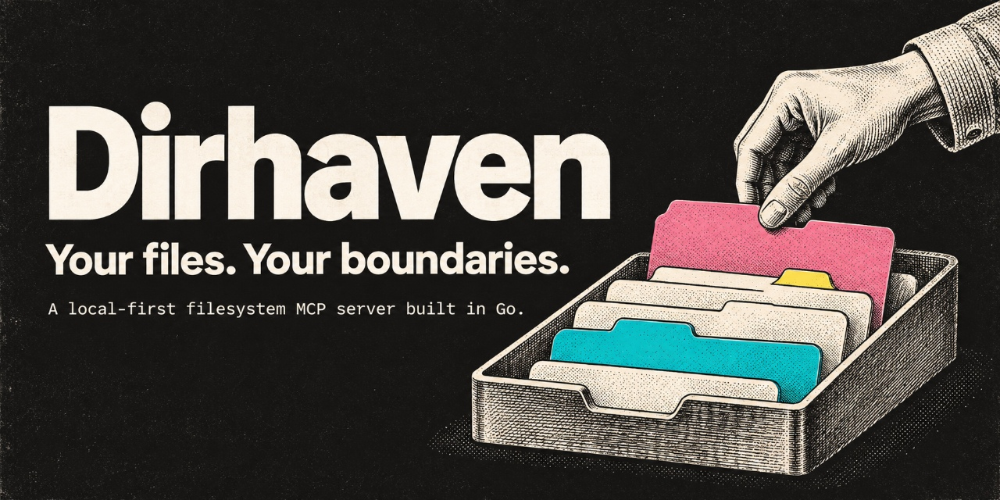

# Dirhaven



**Your files. Your boundaries.**

**Use ChatGPT on the web to work with files on your own computer, inside folders you explicitly authorize.**

Dirhaven is a **local-first filesystem MCP server written in Go**. Its primary use case is connecting ChatGPT Web to your local filesystem through an OpenAI-supported MCP connection, while enforcing explicitly configured directory boundaries. Other MCP clients that support local `stdio` servers can also use Dirhaven directly.

Dirhaven itself runs locally. ChatGPT does **not** connect straight to your computer: this use case requires a separate OpenAI Secure MCP Tunnel and custom MCP plugin configuration. Dirhaven does not ship those components.

> **Status: v0.1.0 is the latest tagged pre-release; `main` includes experimental v0.2.0-dev setup work.** A private ChatGPT Web integration has exercised file read, create, edit and independent disk verification through the standalone Dirhaven backend using an existing Secure MCP Tunnel and plugin. This is not a formal security audit or a publicly reproducible acceptance report. Source code is licensed under Apache-2.0 (see LICENSE); the owner confirms this is a personal project derived from his own earlier code, though no independent legal audit was performed. Third-party modules retain their own licenses.

## Why Dirhaven exists

ChatGPT Web is a powerful place to work through ideas, code, documents, and decisions. But working with a file that already lives on your own computer can mean uploading it, copying its contents into a conversation, or switching to a separate coding or computer-use environment.

**Dirhaven exists to close that gap.** Its goal is to make it possible to stay in a regular ChatGPT Web conversation and ask ChatGPT to find, read, create, edit, or organize files on your computer, **without manually transferring those files into the chat**, once the required connection is configured.

The value is not simply another implementation of a filesystem MCP server. It is the connection between **a web conversation and the user's actual local filesystem**, with access limited to directories the user explicitly authorizes.

Dirhaven is **not** a replacement for Codex CLI, ChatGPT Work, a terminal, or a general-purpose computer-control agent. It provides a focused, locally running filesystem capability. OpenAI's tunnel and plugin infrastructure provide the separate connection into ChatGPT Web.

### The acceptance test that matters

Dirhaven fulfills its primary purpose when a user can open ChatGPT Web, request a change to a file on their own computer, have that change performed through the **standalone Dirhaven server** without manually uploading the file, and confirm that attempts to access files **outside the authorized roots are denied**.

The core ChatGPT Web read/write workflow has been exercised in a private deployment through an existing tunnel and plugin: a temporary file was created, edited, read, and independently checked on disk. **This is evidence for that private integration, not a general security guarantee.** Denial outside authorized roots was not established in this live deployment because its operator enabled `--allow-all-drives`. A reproducible acceptance run with explicit roots and an out-of-root denial check remains a release gate.

## What Dirhaven does

- Enables the **ChatGPT Web -> secure connection -> local files** workflow when the required OpenAI integration is configured.
- Runs locally over **stdio MCP**; it does not start a network server or itself require a cloud account.
- Limits operations to explicitly allowed directory roots using Go filesystem confinement mechanisms.
- Offers **14 compatibility-oriented filesystem tools** plus **3 bounded source-selection tools**.
- Supports reading, searching, listing, creating, editing, moving and inspecting files inside the authorized roots.
- Offers opt-in, metadata-only local call metrics.
- Supports explicit roots on Windows, macOS and Linux. The broader Windows drive-discovery mode is optional, **not a safe default**.

**Dirhaven does not run AI models.** Your MCP client supplies the agent and decides which available tools to call.

## Primary use case: ChatGPT Web accessing local files

Dirhaven provides the local filesystem endpoint. To use it **from ChatGPT in a browser**, an operator must separately connect ChatGPT to that endpoint using OpenAI's **Secure MCP Tunnel** and a **custom MCP plugin**. ChatGPT cannot launch a local `stdio` executable directly from the web interface.

Dirhaven **does not bundle, create, configure, or maintain** OpenAI tunnels, tunnel clients, plugins, account credentials or workspace permissions. Those are external setup requirements, may change independently and may be restricted by account or workspace policies. Follow the official instructions instead of a copied setup tutorial:

- [Connecting custom MCP servers in ChatGPT](https://help.openai.com/en/articles/12584461-connecting-custom-mcp-servers-in-chatgpt)
- [Secure MCP Tunnel](https://developers.openai.com/api/docs/guides/secure-mcp-tunnels)

Once the connection is configured and running, ChatGPT can discover and request Dirhaven tools within the authorized directories, subject to client-side approvals and permissions. **A private ChatGPT Web read/write integration has been verified**, but a published, reproducible acceptance report with explicit allowed roots and denial checks remains a release gate.

The current Secure MCP Tunnel mechanism supports private connections, **not public plugin submission**. Dirhaven is source code that operators can deploy for their own use; it is not a preinstalled ChatGPT plugin. Other compatible MCP clients may connect directly over `stdio` without an OpenAI tunnel.

## Build and run Dirhaven locally

### Requirements

- Go **1.27** or later to build from source.
- A compatible MCP client, or an OpenAI Secure MCP Tunnel configured to launch the local `stdio` server.

### Build

```sh
git clone https://github.com/diegolinan/dirhaven.git
cd dirhaven
go build ./cmd/dirhaven
```

The executable will be `dirhaven.exe` on Windows or `dirhaven` on macOS/Linux.

### Setup Wizard (development preview)

The development branch includes a local browser-based setup assistant. After building from source:

```sh
dirhaven setup
```

The guided interface has three stages: select folders, prepare a connection and try an operation in your MCP client. Returning sessions offer a saved-selection overview; loading never validates or applies that selection automatically. The wizard checks user-selected directory roots, requires explicit confirmation for broad access and prepares a local command and generic stdio MCP configuration example. It links to current OpenAI guidance for configuring an independently owned Secure MCP Tunnel and ChatGPT connection. **This is not yet a native installer:** it does not register services, install tunnel software, capture credentials or create ChatGPT plugins. The setup page is served only on `127.0.0.1` for the life of the command; press Ctrl+C to close it. See [v0.2.0 Setup Wizard scope](docs/SETUP_WIZARD_v0.2.0.md).

### Run

Point the server at one existing directory you deliberately want your agent to access:

```sh
./dirhaven serve --allow /absolute/path/to/workspace
```

Windows PowerShell:

```powershell
.\dirhaven.exe serve --allow 'C:\path\to\workspace'
```

To allow more than one location, repeat `--allow PATH`. The directories must exist. On **Windows, macOS, and Linux**, the person running Dirhaven chooses the authorized paths; Dirhaven does not assume a particular drive letter, home directory, or mount point.

For intentionally broad access on any supported OS:

```sh
dirhaven serve --allow-all
```

On Windows, this dynamically discovers accessible drive-letter roots, including newly mounted drive letters. On Linux and macOS, it authorizes `/`, including filesystem locations mounted underneath it, subject to the account's operating-system permissions. The older Windows-only `--allow-all-drives` flag remains supported for compatibility. **Broad access is optional and does not bypass OS permissions.**

Dirhaven speaks MCP over standard input/output. **It is not an interactive shell**. Configure the OpenAI tunnel client or a compatible local MCP client to launch the binary with the arguments above.

Example for a **local MCP client** (not ChatGPT Web or a Secure MCP Tunnel configuration; replace the binary path and root with paths on your machine):

```json
{
  "mcpServers": {
    "dirhaven": {
      "command": "/absolute/path/to/dirhaven",
      "args": ["serve", "--allow", "/absolute/path/to/workspace"]
    }
  }
}
```

Different MCP hosts may use different configuration formats. This snippet illustrates the command and argument boundary, not a universal configuration schema.

### Optional local metrics

```sh
./dirhaven serve --allow /absolute/path/to/workspace --metrics-file /private/existing-directory/calls.jsonl
```

The metrics file is opt-in. Its parent directory must already exist. Records contain allowlisted tool names, byte counts, timing and error flags, not file contents, requested paths or credentials. Keep the metrics directory private.

## MCP tool surface

The 14 compatibility-oriented filesystem tool names are:

| Category | Tools |
| --- | --- |
| Read | `read_file`, `read_text_file`, `read_media_file`, `read_multiple_files` |
| Write | `write_file`, `edit_file`, `create_directory`, `move_file` |
| Discover and inspect | `list_directory`, `list_directory_with_sizes`, `directory_tree`, `search_files`, `get_file_info`, `list_allowed_directories` |

Three additional tools support bounded, source-preserving retrieval:

- `read_file_lines`: retrieve exact numbered text lines with SHA-256 change detection and pagination.
- `search_text_file`: find literal text in one file, returning original line numbers with bounded output.
- `search_text_files`: search multiple explicitly authorized files with bounded output, cursors and snapshot checks.

These three tools do **not** summarize or semantically interpret source material. They preserve explicit source evidence.

## Access boundaries and limitations

**A filesystem MCP server can modify data.** `--allow` is an access scope, not a read-only permission or a substitute for OS filesystem security.

- Use the smallest practical set of allowed roots, ideally a disposable workspace for first use.
- Do not assume that an AI agent, MCP client or model will make safe decisions just because the server validates paths.
- Dirhaven relies on the operating system's permissions and Go root-confinement APIs; it does not provide process isolation, user impersonation or an OS-level sandbox.
- Do not expose its stdio transport to untrusted remote clients without an independently reviewed security boundary.
- Windows-only `--allow-all-drives` (equivalent to `--allow '*'`) allows **all currently accessible drive letters**, including newly mounted drives. This is deliberately broad and should not be used for a least-privilege deployment.
- Unmapped UNC shares and arbitrary non-drive mount points are not automatically covered by the Windows wildcard.
- Windows drive-letter discovery is specific to Windows. `--allow-all` is supported on all three platforms: Windows discovers drives dynamically; macOS/Linux authorize `/` (including mounts under `/`). Explicit roots remain supported everywhere.

See [Security and compatibility notes](docs/SAFETY_AND_COMPATIBILITY.md) for the precise development claims.

## Development

```sh
go test ./...
go test -race ./...     # requires a race-enabled Go toolchain
go vet ./...
go build ./cmd/dirhaven
```

GitHub Actions runs native jobs on Windows, Ubuntu Linux and macOS. A Windows SUBST drive-mount acceptance test exists but is **opt-in** and is not run by default because it creates a temporary OS-level drive mapping. An optional Node-reference parity test runs only if `FS_NODE_REFERENCE` points to a separately installed compatible reference executable.

Passing these tests does not imply that every OS filesystem feature, edge case or real MCP host integration has been independently validated.

## Scope of this repository

```text
cmd/dirhaven/           Standalone stdio CLI and experimental setup command
internal/setupwizard/   Local browser setup UI and metadata-only root validation
internal/filesystem/    MCP tool handlers, root confinement and tests
internal/mcpmetrics/    Optional content-free local metrics
docs/                   Security and compatibility scope
.github/workflows/      Native CI on Windows, Linux and macOS
```

This repository is a **source-only extraction**. It does not include the private integration repository's Git history, tunnel profiles, vendor executables, accounts, deployment scripts, credentials or personal benchmark transcripts.

## Roadmap

1. **Publish reproducible ChatGPT Web acceptance evidence** with explicit authorized roots and an out-of-root denial check. Private read/write access through an existing tunnel is verified; live denial outside authorized roots is not.
2. Keep the 17 exposed MCP tools compatible and maintain native Windows, Linux and macOS tests; add smoke tests for other MCP clients.
3. Keep dependency license inventories and release packages aligned with pinned module versions.
4. Establish support/versioning guarantees and mature the pre-release distribution process.
5. Continue cross-platform confinement and compatibility testing.

**Licensing:** Dirhaven source code is under [Apache License 2.0](LICENSE), with third-party terms and copies in [third_party/](third_party/README.md). The existing [brand artwork is separately reserved](assets/BRANDING.md). Dependency license copies and release-artifact checks accompany the first pre-release. The owner's source-provenance representation is documented in the release-readiness notes.
